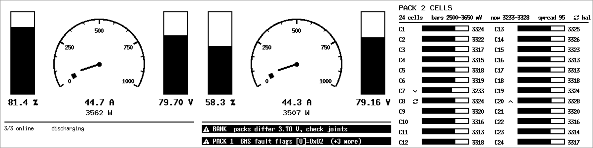

# daly_bms_monitor

A standalone display for three Daly BMS units in parallel on one battery
bank. It polls them over a shared CAN bus and shows state of charge, current
and per-cell health on a small LCD.

The protocol, model and UI are portable C99 and LVGL 9, so any board running
FreeRTOS (or similar) with an LCD and a CAN controller can host it; see
[docs/porting.md](docs/porting.md). A host simulator runs the same code on
Linux against SocketCAN.

*Written with [Claude](https://claude.ai), Anthropic's AI assistant.*

## Reference setup

The code is developed and tested on one concrete setup, used as the example
throughout the docs: three **24S LiFePO4 packs, each with a Daly smart BMS**
(addresses 0x01-0x03), wired in parallel. The display is a
**Waveshare ESP32-S3-RLCD-4.2** (ESP32-S3, 4.2" 400 x 300 reflective monochrome
LCD) in a 3D-printed PLA enclosure, with one push button on the front. It talks to the packs through an **SN65HVD230** transceiver on the
S3's built-in TWAI controller, at 250 kbit/s. On the bench, an
**IXXAT USB-to-CAN V2** connects the laptop to the same bus. Specs, GPIO map and
wiring are in [`docs/hardware/`](docs/hardware/); the short version is in
[wiring.md](docs/hardware/wiring.md#in-short).

## What it shows

| Page         | Contents                                                                                       |
|--------------|------------------------------------------------------------------------------------------------|
| **Overview** | Bank SoC column, 0-350 A current dial with power, voltage column, two-line status footer       |
| **Pack 1-3** | One BMS: SoC, V/A/W, cell min/max and spread, temperatures, MOSFETs, cycles, state             |
| **Cells**    | All 24 cells as bars on the 2.50-3.65 V range, min/max arrowed                                 |



*Simulator output at the panel's resolution and 1 bpp: the overview, the same
with two alarms, and the cells of a drifted pack.*

- The current dial shows **magnitude only**, 0 to `UI_GAUGE_MAX_A`. Direction
  comes from the `CHARGING` legend and the status line.
- Warnings replace the footer lines, worst first: bold with a warning glyph,
  alarms inverted.
- A pack that stops answering shows `NO DATA` and drops out of the bank totals.
- Warning rules are in `core/warnings.c` and unit-tested. Thresholds are
  `#define`s in `core/warnings.h`, set for the reference 24S LiFePO4 bank
  (60.0-87.6 V, also the voltage column's range, `UI_VBAR_CELLS` in `ui/ui.h`).

**Controls:** two inputs, one cycling pages and one opening the cell detail. On
the reference board that is one push button on GPIO1 (or the onboard KEY):
a short press and an 800 ms hold.

## Virtual BMS

The display also broadcasts **the whole bank as one battery** in Victron's
CAN-bus BMS protocol, for the winch controller: `0x355` and `0x356`, 11-bit
identifiers, little-endian, once a second while the display is polling the
packs (`CONFIG_BMS_VICTRON`, on by default). Nothing is asked for: Victron is
push-only. The frames share the packs' bus at 250 kbit/s; a Victron device set
to its usual 500 kbit/s will not hear them.

| Frame   | Field                                | Combined as                       |
|---------|--------------------------------------|-----------------------------------|
| `0x355` | SoC (1 %, and 0.01 % in bytes 4-5)   | mean                              |
| `0x355` | SoH                                  | 100 % (Daly does not report it)   |
| `0x356` | Voltage (0.01 V)                     | mean (the packs share terminals)  |
| `0x356` | Current (0.1 A, + = charging)        | sum                               |
| `0x356` | Temperature (0.1 °C)                 | warmest sensor of any pack        |

Only online packs count. Until a pack has reported its SoC, and whenever every
pack is offline, nothing is sent, so the controller times the battery out
rather than read zeros; without a temperature `0x356` is sent 4 bytes long.
Rules are in `core/virtual_bms.c`.

## Remote reporting

The display can report the bank to the club website and otherwise keep the
bus quiet, so the packs reach their own sleep (they stay awake as long as
anything polls them). It deep-sleeps with "Zzz" on the screen, wakes on a
button press, on bus traffic, or on a timer to check in
with the website, and uploads a snapshot when the site asks for one. While
the screen is on it also posts a live snapshot every few seconds (5 s by
default), and the website page updates itself; the screen stays on for as
long as a pack reports charging or discharging. A small signal-bar icon in
the top right corner shows the Wi-Fi: filled bars when connected, hollow ones
when out of range (normal at the winch), none when no Wi-Fi is set up. Details:
[docs/remote-protocol.md](docs/remote-protocol.md); first flash:
[docs/bring-up-remote.md](docs/bring-up-remote.md). Off with
`CONFIG_BMS_REMOTE=n`: polls forever, as before.

## Layout

```
core/        portable C99: Daly decoding, data model, poll scheduler, warnings,
             virtual BMS. No platform headers, no I/O, no threads.
ui/          LVGL 9 screens, shared by simulator and firmware
port/sim/    host: SocketCAN + SDL
port/esp32/  reference port: ESP-IDF app - TWAI, ST7305 panel, button
tools/       daly_sim.py (fake three-BMS bus), vcan and adapter setup
tests/       host unit tests over core/
docs/        core design, porting guide, fonts, reference hardware
```

## Documentation

| Document | Contents |
|---|---|
| [core-design.md](docs/core-design.md) | How `core/` is built and why |
| [porting.md](docs/porting.md) | What a port to other hardware supplies |
| [fonts.md](docs/fonts.md) | The X11 misc-fixed bitmap fonts and how to regenerate them |
| [hardware/](docs/hardware/) | The reference hardware: board, transceiver, wiring |
| [daly-can-protocol.md](docs/hardware/daly-can-protocol.md) | Daly CAN frames, and what real packs were seen to send |
| [bring-up-usb-can.md](docs/hardware/bring-up-usb-can.md) | First contact with the packs from a laptop |
| [bring-up-board.md](docs/hardware/bring-up-board.md) | First flash of the board, buttons, CAN |
| [remote-protocol.md](docs/remote-protocol.md) | Device ↔ website protocol, snapshot format, rules on both sides |
| [bring-up-remote.md](docs/bring-up-remote.md) | First flash of remote reporting: console, checks, the CAN-wake unknown |

## Building and running on the laptop

Everything except the board drivers (panel, button, CAN controller) runs on the
host against a virtual CAN bus.

```bash
sudo apt install build-essential cmake ninja-build libsdl2-dev can-utils

python3 -m venv .venv
.venv/bin/pip install -r tools/requirements.txt

./tools/setup-vcan.sh              # creates and brings up vcan0

cmake -S . -B build -G Ninja       # fetches LVGL 9.5.0 on first configure
cmake --build build
ctest --test-dir build --output-on-failure
```

If your packs report discharge above Daly's 30000 current bias, configure with
`-DBMS_INVERT_CURRENT=ON` (see `DALY_CURRENT_SIGN` in `core/daly_proto.h`).

Then, in two terminals:

```bash
.venv/bin/python tools/daly_sim.py --scenario weak-cell
./build/sim vcan0
```

Simulator keys: `n` next page, `N` cell detail, `q` quit. It renders at 1 bpp
like the panel; `SIM_REFLECTIVE_TINT` in `port/sim/sdl_display.c` previews the
panel's grey-green background.

### Other host tools

```bash
./build/sim_headless vcan0                  # same core, as text
./build/sim_headless vcan0 --victron        # ...also broadcasting the virtual BMS
./build/test_core                           # unit tests
candump vcan0                               # raw bus
```

### Simulator scenarios

| Scenario    | Exercises                                                     |
|-------------|---------------------------------------------------------------|
| `normal`    | three healthy packs discharging                               |
| `weak-cell` | pack 2 has a cell drifting 120 mV low                         |
| `offline`   | pack 3 silent for 20 s: `NO DATA` and bank totals             |
| `charging`  | current reversed, SoC rising                                  |
| `alarm`     | pack 1 raises an alarm flag                                   |
| `faults`    | enough at once to overflow the footer (`+N more`)             |
| `winch`     | pulls ramping the bank to ~600 A, past the gauge's range      |
| `sleepy`    | packs sleep after 30 s idle; pack 3 wakes slowest             |

`--drop 0.15` discards random replies to exercise multi-frame reassembly.
`daly_sim.py` uses python-can, so it can also drive a real adapter to
bench-test the board:

```bash
.venv/bin/python tools/daly_sim.py -I slcan -i /dev/ttyACM0 -b 250000
```

### Unattended screenshots

```bash
SIM_SCRIPT="3000:n,1500:n,1500:N" SIM_SHOT_DIR=shots SIM_QUIT_MS=12000 \
  ./build/sim vcan0
```

Saves a PPM just before each scripted key press and one at quit.
`tools/make-screenshots.sh` regenerates the images in `docs/img/` this way.

### Real CAN hardware

Both host binaries take the interface name, so a USB-CAN adapter replaces
`vcan0`:

```bash
./build/sim_headless can0 --raw    # every frame with its decode, no filter
./build/sim_headless can0          # decoded model
./build/sim can0                   # the screens
```

Adapters supported in mainline:

```bash
# gs_usb / candleLight / PCAN
sudo ip link set can0 type can bitrate 250000 && sudo ip link set up can0

# slcan (CANable, USBtin) - -s5 is 250 kbit/s
sudo slcand -o -c -s5 /dev/ttyACM0 can0 && sudo ip link set up can0
```

The IXXAT USB-to-CAN V2 needs an out-of-tree driver:
`sudo ./tools/setup-ixxat.sh`.
When the bus looks dead, check `ip -details -statistics link show can0` for
error counters. Both, and the full bench procedure, are in
[bring-up-usb-can.md](docs/hardware/bring-up-usb-can.md).

## Building for the reference board

This section is specific to the ESP32-S3-RLCD-4.2; for other hardware see
[docs/porting.md](docs/porting.md). It needs ESP-IDF **5.5** (built and
tested on 5.5.5): 6.x replaced the `driver/twai.h` API this uses.

```bash
sudo apt install -y flex bison
mkdir -p ~/esp && cd ~/esp
git clone -b v5.5.5 --depth 1 --recursive https://github.com/espressif/esp-idf.git
cd ~/esp/esp-idf && ./install.sh esp32s3
. ~/esp/esp-idf/export.sh                # in every new shell
```

```bash
idf.py -C port/esp32 set-target esp32s3
idf.py -C port/esp32 build
idf.py -C port/esp32 flash monitor
```

Use `-C`, not `cd`: the repository root is the host CMake project. Options
(virtual BMS on/off, current direction, diagnostic modes) are under *Daly BMS
monitor* in `idf.py -C port/esp32 menuconfig`.

### Flashing

One USB-C cable carries flashing and the console (USB serial/JTAG), as
`/dev/ttyACM0`.

| Problem                            | Fix                                                                                     |
|------------------------------------|-----------------------------------------------------------------------------------------|
| Nothing at `/dev/ttyACM*`          | Download mode: hold **BOOT**, click **PWR**, release BOOT. PWR is a latch (long press off) |
| `Permission denied` on the port    | `sudo usermod -aG dialout $USER`, then log in again                                     |
| Flash succeeds, board does not run | `idf.py -C port/esp32 erase-flash`, then flash again (this also wipes the Wi-Fi and token) |
| Wrong port picked                  | add `-p /dev/ttyACM0`                                                                   |

[bring-up-board.md](docs/hardware/bring-up-board.md) walks through the first
flash. Flashing keeps the NVS partition, so the Wi-Fi, token and server
settings survive it; only `erase-flash` clears them.

### Monitor, reset and quitting

The board has no reset button. Ways to restart it:

| How | Notes |
|-----|-------|
| `Ctrl+T`, then `Ctrl+R` in `idf.py monitor` | Resets over the USB cable. Starting `idf.py monitor` also resets the board once. |
| Unplug and replug USB-C | A power-on reset. Not with an 18650 in the holder: the board keeps running on it. |
| Long press **PWR** (off), short press (on) | PWR is a latch. |

Don't hold **BOOT** while the board starts: that is download mode, and the
firmware does not run.

| In `idf.py monitor` | |
|---------------------|--|
| `Ctrl+]` | Quit the monitor (or `Ctrl+T`, then `Ctrl+X`) |
| `Ctrl+T`, `Ctrl+R` | Reset the board |
| `Ctrl+T`, `Ctrl+H` | All monitor keys |

Quit the monitor before flashing from another terminal: only one program can
hold `/dev/ttyACM0`.

### The `bms>` console

With remote reporting on, the board's settings are set over the same USB
serial line, in `idf.py monitor` or any serial terminal on `/dev/ttyACM0`.

**Opening it:** reset the board, wait for the boot log, then **press the
button within 10 seconds** - the log says `console open for 300 s - type help`
and the `bms>` prompt appears. A press held through the reset does not count:
its release is taken as the wake. The console
closes after 5 minutes; while it is open the board does not deep-sleep.

| Command | What it does |
|---------|--------------|
| `help` | Lists the commands |
| `wifi <ssid> [password]` | Wi-Fi network, 2.4 GHz only. Quote a name with spaces: `wifi "Avia Clubhuis" secret`. No password for an open network. A password is 8-63 characters, or 64 hex digits. |
| `token <64 hex>` | The device token from WP admin → Settings → Avia BMS → *Rotate device token* |
| `server <https URL>` | The API base; default `https://www.avia-dpc.be/wp-json/avia-bms/v1`. Only `https://` is accepted. |
| `live <s>` | Seconds between live snapshots while the screen is on, 0 = off (default 5). Takes effect at once; a value set in WP admin overrides it. |
| `min_checkin <s>` | Refuses check-in intervals shorter than this from the server (default 1 = off); a guard against a compromised site draining the power bank |
| `status` | Shows the settings; the password and token only as *set* / *not set* |
| `checkin` | Checks in with the website now; watch the log for the result |

Settings are saved in NVS at once. **Reset after changing `wifi`, `token` or
`server`**: the network starts at boot, and `status` says `network: not
started` until then. A typical first setup:

```
bms> wifi froidcoeur <password>
bms> token <64 hex characters>
(reset, press the button within 10 s)
bms> status          network: running
bms> checkin         log: check-in ok, none, next in 900 s
```

If the Wi-Fi fails, the log names the reason (`reason 201, network not
found`, `refused: wrong password?`, ...). The full bench checklist is
[bring-up-remote.md](docs/bring-up-remote.md).

### Display driver

`port/esp32/main/st7305.c` drives the ST7305, which packs a 4-wide x 2-tall
pixel block per byte (15000 bytes for 300 x 400). The glass scans 300 x 400
portrait, so `flush_cb` rotates the 400 x 300 UI (`BOARD_ROTATE_CW` in
`port/esp32/main/board.c`). LVGL (9.5.0 on both sides)
renders RGB565 and both ports reduce it to one bit with the same
`ui_px_is_paper()`, so the simulator shows exactly what the glass will.

### Threading

Two FreeRTOS tasks: `app_main` on core 0 polls CAN and handles input, and LVGL
renders on core 1 at higher priority, behind a recursive lock. The rules are
in [docs/porting.md](docs/porting.md#5-tasks-and-a-lock-on-an-rtos).
