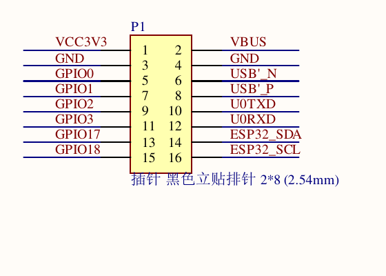

# CAN wiring plan

How the SN65HVD230 transceiver connects the ESP32-S3-RLCD-4.2 to three Daly BMS
units.

## In short

- **Transceiver on the 2x8 expansion header P1:** 3V3 to pin 1, GND to pin 3,
  CAN TX to pin 13 (GPIO17), CAN RX to pin 11 (GPIO3). The front button goes
  between pin 7 (GPIO1) and GND (pin 4).
- **Bus:** CANH/CANL as a twisted pair to the three Daly units, with a ground
  wire alongside. 250 kbit/s, 29-bit extended frames.
- **Termination:** exactly two 120 ohm terminators, at the two physical ends.
  The breakouts ship with one fitted, so lift it on every node that is not an
  end. The unpowered bus should measure about 60 ohm across CANH-CANL.
- **Addresses:** set the BMS board numbers to 0x01/0x02/0x03 with Daly's
  Windows BmsMonitor tool first. They all default to 0x01 and collide.

## Topology

One linear bus, four nodes, common ground.

```
   ESP32-S3-RLCD-4.2                Daly #1      Daly #2      Daly #3
   +----------------+               addr 0x01    addr 0x02    addr 0x03
   |                |                   |            |            |
   |  GPIO_TX ------+---> D  +--------+ |            |            |
   |  GPIO_RX <-----+---- R  |SN65HVD | |            |            |
   |  3V3 ----------+---> Vcc|  230   | |            |            |
   |  GND ----------+---> GND|        | |            |            |
   +----------------+        +-+----+-+ |            |            |
                          CANH |    | CANL           |            |
   [120R]----------------------+----+-----+----------+------------+---[120R]
   end of bus                                                   end of bus
                    (GND run alongside the twisted pair)
```

Because the three packs are wired in **parallel**, they already share battery
negative. There is one common ground reference and no isolation is needed between
BMS units.

## Node budget

One transceiver on the pack bus, and a second one if the Victron frames get
their own bus (below). The pack of five leaves three or four spares.

## Pin assignment

**Resolved from the schematic.** The 2 x 8 header (P1) brings out only six GPIOs,
of which three are freely usable: **GPIO1, GPIO2, GPIO17**. Everything else on the
header is power, USB, UART0, I2C, or an already-committed pin.



TWAI routes through the GPIO matrix and works on any pin. The front button
needs a pin that can wake the chip from deep sleep (an RTC GPIO) and is not a
strap, so it takes GPIO1. Capacitive pads behind the enclosure wall were tried
first and dropped as too unreliable in the winch.

| Signal | P1 pin | GPIO |
|---|---|---|
| CAN TX -> transceiver `D` / `CTX` | **13** | **GPIO17** |
| CAN RX <- transceiver `R` / `CRX` | **11** | **GPIO3** |
| 3V3 -> transceiver `Vcc` | **1** | - |
| GND -> transceiver `GND` | **3** | - |
| button (other leg to GND, pin 4) | **7** | **GPIO1** |

The button is a plain normally-open push button to GND; the internal pull-up
does the rest, awake and asleep. A short press turns the page, a hold over
800 ms opens the cell detail, and a press wakes the board. GPIO2 (pin 9) is
spare.

GPIO3 is nominally the JTAG source-select strap, but that function only exists
once the `JTAG_SEL_ENABLE` eFuse is burned, which it is not from the factory. It
carries **RX rather than TX** deliberately, so the pin sits at a defined level
during boot: the transceiver's `R` output idles high (recessive).

Do not use GPIO0 (pin 5, BOOT strap) or GPIO18 (pin 15, KEY button).

**`D`/`CTX` is an input to the transceiver and takes our TX; `R`/`CRX` is its output and feeds our RX.**
Wired the other way round, two push-pull drivers end up on one net - which
during bring-up destroyed a transceiver and cost most of an evening to find,
because every symptom pointed at the bus instead.

For the full P1 pinout see
[esp32-s3-rlcd-4.2.md](esp32-s3-rlcd-4.2.md#the-2-x-8-expansion-header-p1).

## Second bus for the Victron frames

Optional, with `CONFIG_BMS_VICTRON_SEPARATE_BUS`. The Daly packs only speak
250 kbit/s, and a Victron-style controller usually listens at 500, so the
0x355/0x356 frames get their own bus. The S3 has one CAN controller: once a
second, in the gap before the next Daly request, the firmware reinstalls it on
the second transceiver at 500 kbit/s, sends the two frames, and moves back.
That takes about a millisecond, or 5 ms when nothing on that bus acknowledges.

| Signal | P1 pin | GPIO |
|---|---|---|
| CAN TX -> 2nd transceiver `D` / `CTX` | **12** | **GPIO44** (U0RXD) |
| CAN RX <- 2nd transceiver `R` / `CRX` | **9** | **GPIO2** |
| 3V3, GND | 1, 3 | shared with the first transceiver |
| `Rs` | - | **the same line as the first transceiver's Rs** (`CONFIG_BMS_CAN_RS_GPIO`) |

- **10k pull-up from `D` to 3V3.** GPIO44 floats at boot and in deep sleep, and
  a floating `D` can hold the bus dominant. The pull-up keeps it recessive.
- **Shared Rs**: both transceivers go to standby in deep sleep. Only the pack
  bus wakes the board.
- **Never GPIO43** (P1 pin 10). The ROM prints its boot log on U0TXD at every
  reset. On `D` that puts garbage on the Victron bus. On `R` it fights the
  transceiver's output: two push-pull drivers on one net, the fault that
  already killed one transceiver here.
- **Its own segment.** A separate twisted pair to the winch controller, 120 ohm
  at both ends (about 60 ohm across CANH-CANL unpowered), ground alongside. Do
  not join it to the pack bus.

Bring it up like the first one: the loop test build checks both transceivers,
then an adapter at 500 kbit/s on the second bus should see `0x355`/`0x356` once
a second, and the pack bus should no longer carry them.

## Bus parameters

| | |
|---|---|
| Bit rate | 250 kbit/s |
| Frame format | 29-bit extended |
| Termination | 120 ohm at each of the two physical ends, and nowhere else |
| Cable | Twisted pair for CANH/CANL, ground wire alongside |
| Stubs | As short as practical - under about 30 cm |

Check termination with a multimeter before powering anything: across the assembled,
unpowered bus, CANH-CANL should read about **60 ohm**. See
[sn65hvd230.md](sn65hvd230.md#termination).

## Safety during development

With USB-C plugged into the laptop, laptop ground becomes tied to pack negative
through the CAN ground. On a live battery bank that is a real hazard and a real
route to a dead laptop.

Either:

- run the board from its 18650 (or another floating supply) whenever it is
  connected to the live bank, **or**
- use a USB isolator between laptop and board.

Do the first bring-up steps on the bench, off the bank, where this does not arise.

## Bring-up order

Work up in stages. Do not connect three BMS units to a live bank as the first test.

### 1. Bench loopback

ESP32 + transceiver + a second CAN node (USB-CAN adapter, or a second ESP32 with
another transceiver) on a short terminated pair. Prove frames go both ways at
250 kbit/s. This validates the transceiver wiring, the Rs mode, the GPIO choice,
and the bit timing in isolation.

If the bus is silent here, check in this order: Rs floating or tied high; TX/RX
swapped; only one terminator fitted; wrong bit rate.

### 2. One BMS, raw logging

Connect a single Daly, still off the main bank if possible. Flash the raw frame
logger build and dump every received identifier and payload over USB serial.

Confirm the unit answers `0x18900140` with source `0x18904001`. Then check every
field layout in [daly-can-protocol.md](daly-can-protocol.md) against Daly's own
app running on the same pack - particularly the 30000 current offset, the 40
temperature offset, and the multi-frame `0x95` cell ordering.
**Fix the parser before trusting the UI.**

### 3. Re-address packs 2 and 3

With Daly's Windows **BmsMonitor** tool, set the board number of the second unit to
`0x02` and the third to `0x03`. The Smart BMS phone app does not set this
reliably.

Verify each responds on its own address individually, one at a time, before
bussing them together.

### 4. All three together

Bus all three plus the ESP32. Confirm three distinct source addresses reply within
one poll round, and that unplugging one connector greys exactly that pack on screen
within the timeout - and no others.

### 5. On the bank

Move to the live parallel bank, on battery or isolated USB. Cross-check SoC, pack
voltage and current for each pack against Daly's app.
